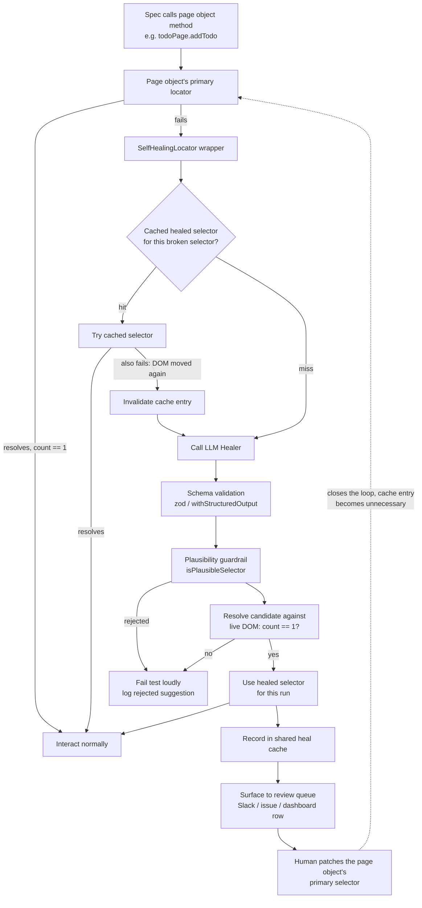

# Self-healing locators: from toy challenge to production architecture

*Oct 19, 2026 · Sándor Orosz*

[Challenge 2](../challenges/02-self-healing-locators/) in this repo teaches a real
concept -- hand a broken CSS selector and a DOM snapshot to Claude, validate what
comes back with a schema *and* a plausibility guardrail, then use it -- inside a
test spec that is deliberately minimal. `self-healing.spec.ts` calls the broken
locator, catches the failure, calls `healer.heal()` directly, and retries, all in
one `test()` block.

That shape is right for teaching the healer in isolation. It is not the shape a
real suite should take. This article is the gap between the two: a reference
architecture for where self-healing actually belongs in a Playwright suite, and
what the toy challenge leaves out on purpose.

Self-healing locators aren't a novel idea -- commercial tools like Testim and
Healenium (an open-source Selenium/Playwright add-on) have shipped versions of this
for years. The interesting engineering problem isn't "can an LLM guess a selector."
It's "how do you let it guess without making your suite slow, flaky, or silently
wrong."

## What the toy challenge deliberately skips

Three things, each for a good reason inside a learning exercise, each a problem in
production:

1. **The spec knows about healing.** `self-healing.spec.ts` explicitly orchestrates
   try → catch → heal → retry. A real spec should call `todoPage.addTodo(title)`
   and know nothing about healing at all -- that logic belongs one layer down, in
   the page object, so every test benefits without every test author writing
   recovery boilerplate.
2. **The LLM is called every run, with no memory.** Fine for a single demo test.
   In a CI suite run on every PR, calling a model synchronously on every locator
   failure is slow, costs money per run, and reintroduces non-determinism into a
   signal that's supposed to be deterministic. A real implementation caches a
   healed selector the first time and only re-heals when the cached one *also*
   stops working.
3. **The guardrail only checks the string, never the page.** `isPlausibleSelector`
   (see [`guardrail.ts`](../challenges/02-self-healing-locators/guardrail.ts))
   rejects prose and the broken selector echoed back -- it's a static check on a
   string, not a dynamic check against the DOM. It can't know `healedSelector`
   actually matches exactly one element on the real page, because the challenge's
   job is to teach schema validation + plausibility, not locator semantics. A
   production system has the live page available and should use it: resolve the
   candidate and check `count() === 1` before trusting it for anything.

And, per [`learning/04-guardrails-and-trust.md`](../learning/04-guardrails-and-trust.md),
one thing the challenge gets right and production should keep: a healed selector is
a *suggestion surfaced to a human*, not a self-authorizing permanent fix. The
architecture below treats the cache as a way to keep the suite green between runs,
not as a replacement for someone patching the page object's source selector.

## Reference architecture



Five components do the work:

- **The healer unit** -- unchanged from the challenge: a prompt, a schema
  (`LocatorHealResultSchema`), and `isPlausibleSelector`. This is the part worth
  keeping exactly as designed; it's a self-contained, testable piece.
- **A locator wrapper** -- lives in the page object, not the spec. Tries the
  primary selector, then the cache, then the healer, in that order, and is the
  *only* thing that knows healing exists.
- **A shared cache** -- keyed by the broken selector (scoped to the page), so the
  LLM is called once per real DOM change, not once per test run.
- **A live-DOM check** -- the guardrail the challenge can't have: resolve the
  candidate against the actual page and require exactly one match before using it.
- **A review surface** -- healing keeps the suite green *today*; it doesn't fix the
  source. Every heal event should be visible to a human who can decide whether to
  patch the page object permanently.

## Implementation: the locator wrapper (Playwright)

This is the piece that keeps healing out of every spec file. It reuses the
`LocatorHealer` interface and `HealInput` type from the challenge unchanged.

```ts
// tests/support/SelfHealingLocator.ts
import type { Locator, Page } from '@playwright/test';
import type { LocatorHealer } from '../../challenges/02-self-healing-locators/healer.types';
import type { HealCache } from './HealCache';

interface SelfHealingLocatorOptions {
  page: Page;
  primarySelector: string;
  intentDescription: string;
  healer: LocatorHealer;
  cache: HealCache;
  /** Scope the DOM snapshot sent to the model -- keep context small and the blast
   *  radius of prompt injection (see learning/04-guardrails-and-trust.md) narrow. */
  domScope: string;
  /** How long to give a selector to become visible before treating it as broken
   *  rather than just slow. Short on purpose -- see "Where Playwright's own
   *  retries fit in" below. Playwright's own action timeout (default 30s) is for
   *  interacting with an element already known to exist; this is a separate,
   *  tighter budget for "does this selector exist at all." */
  existenceTimeoutMs?: number;
}

export class SelfHealingLocator {
  constructor(private readonly opts: SelfHealingLocatorOptions) {}

  async resolve(): Promise<Locator> {
    const { page, primarySelector, cache } = this.opts;
    const primary = page.locator(primarySelector);
    if (await this.isUsable(primary)) return primary;

    const cached = cache.get(primarySelector);
    if (cached) {
      const candidate = page.locator(cached);
      if (await this.isUsable(candidate)) return candidate;
      cache.invalidate(primarySelector); // the DOM moved on again; re-heal below
    }

    return this.heal();
  }

  private async heal(): Promise<Locator> {
    const { page, primarySelector, intentDescription, healer, cache, domScope } = this.opts;
    const domSnapshot = await page.locator(domScope).innerHTML();

    const { healedSelector, reasoning } = await healer.heal({
      domSnapshot,
      brokenSelector: primarySelector,
      intentDescription,
    });

    const candidate = page.locator(healedSelector);
    if (!(await this.isUsable(candidate))) {
      // The schema and the plausibility guardrail already ran inside healer.heal().
      // This is the check neither of those can do: does it actually resolve, here,
      // on the real page, to exactly one element?
      throw new Error(
        `Healer suggested "${healedSelector}" (${reasoning}) but it doesn't resolve ` +
          `to exactly one element on the live page. Not trusting it.`,
      );
    }

    cache.record(primarySelector, healedSelector, reasoning);
    return candidate;
  }

  /** Waits a bounded amount of time -- *not* a single immediate check -- so a
   *  slow-rendering element isn't misdiagnosed as a broken selector. Still much
   *  shorter than Playwright's default action timeout, so a genuinely broken
   *  selector fails fast and falls through to healing instead of stalling the
   *  suite. This is the one place this wrapper has to do its own waiting --
   *  Playwright's auto-waiting on `.fill()` / `.click()` only kicks in *after*
   *  resolve() has already handed back a locator it's decided to trust. */
  private async isUsable(locator: Locator): Promise<boolean> {
    try {
      await locator.first().waitFor({ state: 'visible', timeout: this.opts.existenceTimeoutMs ?? 3000 });
      return (await locator.count()) === 1;
    } catch {
      return false;
    }
  }
}
```

The page object wires it up, and the spec stays oblivious:

```ts
// tests/pages/TodoPage.ts (illustrative -- not the version in this repo)
export class TodoPage {
  private readonly newTodoLocator: SelfHealingLocator;

  constructor(page: Page, healer: LocatorHealer, cache: HealCache) {
    this.newTodoLocator = new SelfHealingLocator({
      page,
      primarySelector: 'input.new-todo',
      intentDescription: 'the input field for adding a new todo',
      healer,
      cache,
      domScope: '.todoapp',
    });
  }

  async addTodo(title: string): Promise<void> {
    const input = await this.newTodoLocator.resolve();
    await input.fill(title);
    await input.press('Enter');
  }
}
```

```ts
// some.spec.ts -- no healing logic in sight
test('adds a todo', async ({ page }) => {
  const todoPage = new TodoPage(page, createHealer(), sharedHealCache);
  await todoPage.goto();
  await todoPage.addTodo('Buy milk');
  await expect(todoPage.item('Buy milk')).toBeVisible();
});
```

## Where Playwright's own retries fit in

Playwright already has two retry mechanisms, and it's worth being precise about
how this wrapper relates to each -- because getting this wrong either makes the
suite needlessly flaky or hides real problems.

**Action and assertion auto-waiting** -- `.fill()`, `.click()`,
`expect(locator).toBeVisible()`, and friends all poll the DOM until the action
timeout (30s by default), not just once. This wrapper doesn't replace that; it sits
*in front of* it. Once `resolve()` hands back a `Locator` it has decided to trust,
every interaction on it still gets Playwright's normal auto-waiting for free.
What auto-waiting *can't* do is the thing `resolve()` exists for: decide whether a
selector that currently matches nothing is slow or wrong. An early version of
`isUsable()` used a single `locator.count()` call with no wait at all -- which
would misdiagnose a slow-rendering (but correct) selector as broken on every
page-load hiccup, firing an LLM call it didn't need. The fixed version above waits
briefly (`waitFor({ state: 'visible', timeout: existenceTimeoutMs })`, a few
seconds) before concluding "broken" -- long enough to absorb normal rendering
delay, short enough that an actually-broken selector still fails fast and falls
through to healing instead of stalling the suite toward the full 30s default.

**Test-level `retries`** (`playwright.config.ts`, or `--retries` on the CLI) --
if a test fails outright, Playwright reruns the *entire test* from scratch. This
is a coarser, healing-unaware mechanism: it has no idea `resolve()`, caching, or
the guardrail exist, so a retry just redoes the whole flow blind. Don't lean on
`retries` to paper over an unreliable heal -- that's the same "silently retry with
a different prompt until something passes the guardrail" anti-pattern
[`learning/04-guardrails-and-trust.md`](../learning/04-guardrails-and-trust.md)
calls out as a thing to avoid, just moved up a layer. If a heal is unreliable
enough that it needs several test-level retries to pass, that's a signal to fix
the guardrail or the prompt, not to raise `retries`.

So: independent, but layered on purpose. Auto-waiting handles "the element exists,
wait for it to become actionable." `resolve()` handles "does the element exist at
all, and if not, can it be healed." `retries` should stay a safety net for
infrastructure flakiness (a slow CI runner, a flaky network call), not a substitute
for either.

## Implementation: the healer (LangChain)

The healer itself doesn't need to change from the challenge's solution -- this is
the part that was already designed correctly in isolation. For reference, this is
the `@langchain/anthropic` path from
[`solutions/healer.langchain.ts`](../challenges/02-self-healing-locators/solutions/healer.langchain.ts):

```ts
import { ChatAnthropic } from '@langchain/anthropic';
import { getAnthropicApiKey, getModel } from '../../../src/llm/env';
import { LocatorHealResultSchema, type HealInput, type LocatorHealer } from '../healer.types';
import { isPlausibleSelector } from './guardrail';

const SYSTEM_PROMPT = `A Playwright CSS locator broke because the app's DOM changed.
Given the current DOM snapshot, the selector that no longer matches anything, and a
plain-English description of what element the test is trying to find, return ONE
corrected CSS selector that matches exactly that element in the snapshot. Prefer stable
attributes (data-testid, class, aria-label) over brittle structural selectors.`;

export class LangchainLocatorHealer implements LocatorHealer {
  async heal(input: HealInput) {
    const model = new ChatAnthropic({
      model: getModel(),
      apiKey: getAnthropicApiKey(),
      temperature: 0,
    }).withStructuredOutput(LocatorHealResultSchema);

    const result = await model.invoke([
      { role: 'system', content: SYSTEM_PROMPT },
      {
        role: 'user',
        content: [
          `Broken selector: ${input.brokenSelector}`,
          `Intent: ${input.intentDescription}`,
          `DOM snapshot:\n${input.domSnapshot}`,
        ].join('\n\n'),
      },
    ]);

    if (!isPlausibleSelector(result.healedSelector, input.brokenSelector)) {
      throw new Error(`Guardrail rejected implausible selector: "${result.healedSelector}"`);
    }

    return result;
  }
}
```

`withStructuredOutput` guarantees the shape; `isPlausibleSelector` guards the
content. Neither one, by design, touches the live page -- that's the wrapper's job,
one layer up, shown above.

## Implementation: the shared cache

A file-backed cache is enough for a single-runner suite or local dev. It is **not**
enough for sharded CI with parallel workers -- those need a shared store (Redis, a
small DB table, even a committed JSON file updated via PR if heals should be rare
and reviewed). The shape stays the same regardless of backend:

```ts
// tests/support/HealCache.ts
import { existsSync, readFileSync, writeFileSync } from 'node:fs';

interface HealEntry {
  healedSelector: string;
  reasoning: string;
  healedAt: string;
}

export class HealCache {
  private entries: Record<string, HealEntry>;

  constructor(private readonly filePath: string) {
    this.entries = existsSync(filePath) ? JSON.parse(readFileSync(filePath, 'utf-8')) : {};
  }

  get(brokenSelector: string): string | undefined {
    return this.entries[brokenSelector]?.healedSelector;
  }

  record(brokenSelector: string, healedSelector: string, reasoning: string): void {
    this.entries[brokenSelector] = { healedSelector, reasoning, healedAt: new Date().toISOString() };
    writeFileSync(this.filePath, JSON.stringify(this.entries, null, 2));
  }

  invalidate(brokenSelector: string): void {
    delete this.entries[brokenSelector];
    writeFileSync(this.filePath, JSON.stringify(this.entries, null, 2));
  }
}
```

## Closing the loop: surface, don't auto-patch

The cache keeps the suite green between the moment a selector breaks and the moment
someone fixes the source. It should never be the end of the story. Every heal event
is a signal that the page object's selector is now wrong and needs a real patch --
so emit it somewhere a human will see it, separate from pass/fail noise:

```ts
function surfaceForReview(event: {
  page: string;
  brokenSelector: string;
  healedSelector: string;
  reasoning: string;
}): void {
  console.log(
    `[selector-heal] page=${event.page} broken="${event.brokenSelector}" ` +
      `healed="${event.healedSelector}" reasoning="${event.reasoning}"`,
  );
  // In CI: push this to wherever humans actually look -- a Slack webhook, a
  // GitHub issue, a row on a dashboard. The cache buys time; it doesn't fix
  // anything on its own, and nothing here should patch source files automatically.
}
```

That restraint is the same one `self-healing.spec.ts` already models at the spec
level: when the guardrail rejects a suggestion, the test fails loudly rather than
silently retrying or patching itself. The production version just adds a second
half -- when the guardrail *accepts* a suggestion, that's also a fact for a human to
see, not a problem that's now solved forever.

## The gap, side by side

| | Toy challenge (Challenge 2) | Production architecture |
|---|---|---|
| Who calls `heal()` | The spec, explicitly | The page object's locator wrapper, invisibly |
| How often the LLM runs | Every test run | Once per real DOM change, via cache |
| What the guardrail checks | String shape + plausibility only | That, plus live resolution (`count() === 1`) |
| What happens after a successful heal | Nothing -- the result is used once and discarded | Cached for reuse, and surfaced to a human |
| Concurrency | Single process, not a concern | Shared cache across parallel workers/shards |

## Where this came from

This grew out of a question while working through
[`challenges/02-self-healing-locators/`](../challenges/02-self-healing-locators/) in
this repo: would you actually wire a healer into a suite the way
`self-healing.spec.ts` does? No -- that file exists to exercise the healer unit
(schema validation, the plausibility guardrail, the prompt-injection boundary of
handing an LLM a DOM snapshot) in isolation, which is exactly what a focused test
fixture should do. The architecture above is where that unit plugs into a real
suite once the concept is understood.
